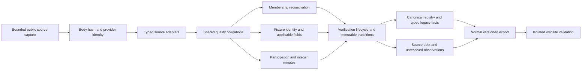

# Shared acquisition and verification pipeline

Onboarding enumerates a declared team/season source scope. Backfill, normal
incremental ingestion and delayed/checkpoint reconciliation use the same
`quality_pipeline` contracts; only discovery breadth differs. Live ingestion
rejects completed matches without a valid ordinary score before canonical writes.
Old accepted facts remain references, not newly certified field evidence.

`quality_membership` records both directions of roster reconciliation. An
appearance is never management proof. Official roster/profile and provider DOB
identity bridges support current management; provider-only transfers remain
unverified. Current snapshots do not invent historical start dates. Evidence of
academy affiliation is persisted in the existing roster dossier model; it cannot
downgrade an already verified first-team player.

`quality_fixture` distinguishes identity from completeness. Verified ordered
team IDs, provider match identity, competition, season and time/uncertainty are
required. Completed ordinary scores require two integers. Unstarted provider
0–0 placeholders become unavailable scores while raw observations are retained.
A preferred onboarding ID never overrides an existing provider binding or a
unique physical fixture with exact canonical teams/UTC/competition/season.
Two registered canonical IDs are never implicitly merged.

`quality_lifecycle` evaluates independently scoped obligations. Required evidence
must include a provider, retained locator and 64-hex body hash. VERIFIED is not
STABLE. Stable fixtures require an explicit independent raw/directory/export
review tied to their fingerprint. This scope excludes membership and player
minutes. Source changes, relevant player-history changes, pending obligations,
canonical corrections/conflicts and audit triggers reopen targeted checks.
Transport timestamps alone are not facts. Stable source reuse checks canonical
ledger consistency; it does not hide valid later corrections.

Unknown bench participation is not zero. Integer source minutes and explicit
participation claims are validated against exact profile, match, ordered team,
competition and kickoff identities. The existing <=5-minute source-priority
policy is retained; played/not-played contradictions are not minute tolerances.
Persistence rejects contradictory new facts and keeps accepted facts/quality
separate from a conflicting new source observation.

Schema changes add quality tables and append-only transitions. They do not drop
old tables, regenerate old IDs, remove observations or resolve acquisition tasks.
Canonical field decision provenance can gain corroborating observations without
changing an old selected value/state; acceptance reports this separately from
immutable football fact preservation.

The normal export includes accepted fixture-level rows even without player
records, plus separate pending/source issues. Export rechecks ledger evidence,
provider binding and canonical values. A historical provider lacking newer field
certificates cannot hide a newly verified provider for the same canonical event.
The website renders ordered teams, scores/status and provisional future times;
source issues never become appearances. No production team configuration or
schedule is activated by this candidate.
